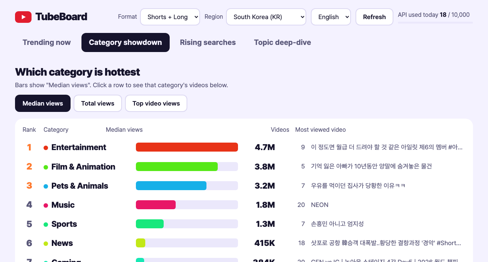

# TubeBoard

English · [한국어](README.md)



A small local program that shows what is trending on YouTube and Google in **one web page**. Pick a region and a period in the browser instead of reading terminal output.

What it shows
- **Trending now**: the top 50 trending videos by region, the category mix, and how many are Shorts vs long-form
- **Category showdown**: median and total views of the top 20 trending videos per category, with one row of videos per category (about 20 quota units)
- **Rising searches**: what people are searching on Google right now (no key or quota needed)
- **Topic deep-dive**: enter a topic and see the most viewed Shorts of the last N days, plus **breakouts from channels under 10K subscribers** ordered by views divided by subscribers. Big channels succeed because of their audience, so there is little to copy; when a small channel's video takes off, the topic or format itself worked. This is an assumption, not a fact.

Instagram is not included because Reels of other accounts cannot be read through an official API.

The interface is available in Korean and English. Use the language selector at the top right; the first load follows your browser language.

## Install

You only need Python 3.9 or later. No external packages.

```bash
git clone https://github.com/everframe-studio/tubeboard.git
cd tubeboard
cp .env.example .env     # open it and paste your own key after YOUTUBE_API_KEY=
python3 -m tubeboard
```

Open http://127.0.0.1:8765 in a browser. Change the port with `TREND_PORT` in `.env`. If another program already uses 8765, startup fails with an error, so pick another number.

Tested on macOS only. On Windows the command may be `python` or `py -m tubeboard`. [unverified]

## Get a YouTube API key

1. Create a project at https://console.cloud.google.com.
2. In "APIs & Services → Library", enable **YouTube Data API v3**.
3. Under "Credentials → Create credentials → API key", create a key and paste it into `.env`.
4. Keep the key to yourself and never commit it (`.env` is in `.gitignore`).

Only public data is read, so no OAuth sign-in is needed.

## Daily quota

The YouTube Data API gives each project **10,000 units per day** by default (reset at midnight Pacific time).

| Action | Units |
|---|---|
| Trending (50 videos + subscriber counts) | about 2 |
| One topic search (search + videos + subscribers) | about 102 |

A topic search is expensive, so results are cached in `.cache/` (trending 30 minutes, Google Trends 15 minutes, category showdown 1 hour, topic search 3 hours). The top right of the page shows an estimate of today's usage (only what this program used). "Refresh" skips the cache and uses quota.

## Structure

```
tubeboard/
  logic.py     pure functions (duration parsing, subscriber ratio, small-channel selection, Google RSS parsing)
  youtube.py   YouTube Data API calls (API key)
  cache.py     disk cache and daily usage estimate
  server.py    standard-library HTTP server (reachable from 127.0.0.1 only)
  static/index.html   the single page
tests/test_logic.py   python3 tests/test_logic.py
```

## Tests

```bash
python3 tests/test_logic.py
```

## Good to know

- The median in a topic search is measured within the top 25 by views, so it reflects the high end, not a typical video on that topic.
- Channels that hide their subscriber count have no ratio and are left out of the small-channel list.
- Auto-generated "- Topic" music channels are not counted as small channels.
- The Pretendard font (SIL OFL 1.1) is bundled in `tubeboard/static/fonts/`; the full license is `LICENSE-Pretendard.txt` in the same folder. It works offline.
- The server listens on your own computer only. Do not expose it to the internet as is, or others could use your key's quota.

## License

MIT (see LICENSE)

## Notices

- This is an unofficial tool and is not affiliated with YouTube or Google. YouTube is a trademark of Google LLC.
- It runs on your own YouTube Data API key. When using it you must follow the [YouTube Terms of Service](https://www.youtube.com/t/terms), the [YouTube API Services Terms of Service](https://developers.google.com/youtube/terms/api-services-terms-of-service) and the [Developer Policies](https://developers.google.com/youtube/terms/developer-policies). This program uses YouTube API Services, and the [Google Privacy Policy](https://policies.google.com/privacy) applies.
- **Calculated values**: subscriber ratios, medians and category totals are calculated by this program from API data and are not provided by YouTube.
- **Privacy**: there is no server or account. It runs only on your computer (127.0.0.1) and does not collect or send user data. Fetched results are stored in `.cache/` on your computer for 15 minutes to 3 hours.
- The **Rising searches** tab reads the RSS feed that Google Trends publishes. I could not confirm whether this counts as scraping under the YouTube API terms. [unverified] If that concerns you, do not use that tab; it does not affect your key or quota.

## Contributing

Issues and suggestions are welcome through the repository's Issues.
