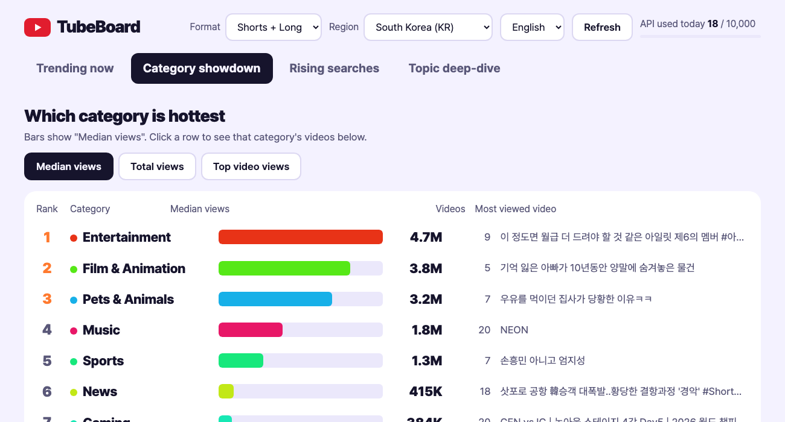

# 튜브보드 (TubeBoard)

[English](README.en.md) · 한국어

**[데모 화면 열어 보기](https://everframe-studio.github.io/tubeboard/)** (한국 지역 스냅샷, 실시간 아님)



유튜브와 구글에서 요즘 뭐가 뜨는지 **웹 화면 하나**로 보는 작은 프로그램입니다. 터미널 출력을 읽을 필요 없이 브라우저에서 지역과 기간을 바꿔 가며 확인합니다.

보여 주는 것
- **인기 급상승**: 지역별 유튜브 인기 급상승 50개, 분류 비율, 쇼츠와 롱폼 개수
- **카테고리 비교**: 카테고리별 인기 급상승 상위 20개의 조회수 중앙값과 합계를 비교하고, 카테고리마다 영상 한 줄씩 보여 줌 (약 20유닛)
- **구글 급상승 검색어**: 지금 많이 검색되는 말 (키와 한도가 필요 없음)
- **주제별 쇼츠**: 주제를 입력하면 최근 N일 쇼츠의 조회 상위, 그리고 **구독자 1만 미만 채널에서 터진 영상**을 조회/구독자 배수 순으로 보여 줌. 큰 채널은 구독자 덕이라 따라 할 것이 적고, 작은 채널의 영상이 터졌다면 주제나 형식이 먹힌 것이라는 가정입니다

기본 지역은 한국이고, 화면에서 12개 지역(한국·미국·일본·영국·독일·프랑스·브라질·인도·인도네시아·대만·베트남·태국)으로 바꿀 수 있습니다. 카테고리 비교와 급상승 검색어도 선택한 지역 기준입니다.

인스타그램은 공식 API 로 남의 릴스를 읽을 수 없어 넣지 않았습니다.

## 가장 쉬운 방법: 더블클릭 실행

1. [릴리스 페이지](https://github.com/everframe-studio/tubeboard/releases)에서 본인 운영체제용 압축 파일(`tubeboard-windows.zip` 또는 `tubeboard-mac.zip`)을 받아 풉니다.
2. `tubeboard`(윈도우는 `tubeboard.exe`)를 실행합니다. 검은 창이 뜨고 브라우저가 저절로 열립니다.
3. 처음 한 번, 화면에 나오는 입력칸에 본인 YouTube API 키를 붙여넣습니다(아래 「YouTube API 키 발급」). 키는 이 컴퓨터에만 저장됩니다.
4. 끝낼 때는 검은 창을 닫습니다.

파이썬 설치가 필요 없습니다. 서명되지 않은 프로그램이라 처음 실행할 때 경고가 뜹니다. 윈도우는 「추가 정보 → 실행」, 맥은 파일을 우클릭해 「열기」를 누릅니다. 믿기 어려우면 아래처럼 소스로 실행하세요. 코드는 전부 이 저장소에 있습니다.

## 설치 (소스로 실행)

Python 3.9 이상만 있으면 됩니다. 외부 패키지는 필요 없습니다.

```bash
git clone https://github.com/everframe-studio/tubeboard.git
cd tubeboard
python3 -m tubeboard     # 브라우저가 열리고, 키는 화면에서 넣습니다 (.env 에 직접 적어도 됩니다)
```

브라우저가 저절로 열립니다. 안 열리면 터미널에 나온 주소(기본 http://127.0.0.1:8765)를 엽니다. 8765 를 다른 프로그램이 쓰고 있으면 빈 번호를 자동으로 찾습니다. 화면 오른쪽 위의 언어 선택(한국어 / English)으로 바꿀 수 있습니다. 처음에는 브라우저 언어를 따릅니다. 포트는 `.env` 의 `TREND_PORT` 로 바꿉니다. 이미 다른 프로그램이 8765 를 쓰고 있으면 시작할 때 오류가 나니 다른 번호를 넣으세요.

## YouTube API 키 발급

1. https://console.cloud.google.com 에서 프로젝트를 만듭니다.
2. 「API 및 서비스 → 라이브러리」에서 **YouTube Data API v3** 를 사용 설정합니다.
3. 「사용자 인증 정보 → 사용자 인증 정보 만들기 → API 키」를 만들고, 복사해 화면의 입력칸에 붙여넣습니다 (`.env` 에 `YOUTUBE_API_KEY=` 로 적어도 됩니다).
4. 키는 본인만 보관하고 git 에 올리지 않습니다 (`.env` 는 `.gitignore` 에 들어 있습니다).

공개 데이터만 읽으므로 OAuth 로그인은 필요 없습니다.

## 하루 한도

유튜브 Data API 는 프로젝트마다 **하루 10,000 유닛**이 기본입니다 (태평양시 자정에 초기화, 한국 시간으로 오후 4~5시).

| 동작 | 유닛 |
|---|---|
| 인기 급상승 (영상 50개 + 구독자 조회) | 약 2 |
| 주제 검색 한 번 (검색 + 영상 + 구독자) | 약 102 |

주제 검색이 비싸서, 같은 조회를 반복하면 한도가 금방 찹니다. 그래서 결과를 `.cache/` 에 저장해 재사용합니다 (인기 급상승 30분, 구글 트렌드 15분, 주제 검색 3시간). 화면 오른쪽 위에 오늘 쓴 양을 추정해 보여 줍니다(이 프로그램에서 쓴 것만 센 값). 「새로 읽기」 버튼은 저장된 결과를 건너뛰므로 한도를 씁니다.

## 구조

```
tubeboard/
  logic.py     순수 함수 (길이 해석, 구독자 배수, 작은 채널 선별, 구글 RSS 해석)
  youtube.py   YouTube Data API 호출 (API 키)
  cache.py     디스크 캐시와 하루 사용량 추정
  paths.py     설정·캐시 폴더 (실행 파일판은 사용자 폴더)
  server.py    표준 라이브러리 HTTP 서버 (127.0.0.1 에서만 접속 가능)
  static/index.html   화면 한 장
tests/test_logic.py   python3 tests/test_logic.py
```

## 시험

```bash
python3 tests/test_logic.py
```

## 알아 둘 점

- 주제 검색의 중앙값은 조회순 상위 25개 안에서 잰 값이라 그 주제의 보통 영상이 아니라 잘 나가는 쪽의 수준입니다.
- 구독자를 숨긴 채널은 배수를 계산하지 못해 작은 채널 목록에서 빠집니다.
- 음원 유통으로 자동 생성된 「- Topic」 채널은 작은 채널로 치지 않습니다.
- 글꼴은 Pretendard(SIL OFL 1.1)를 `tubeboard/static/fonts/` 에 함께 넣었습니다. 라이선스 전문은 같은 폴더의 `LICENSE-Pretendard.txt` 입니다. 인터넷 없이도 같은 글꼴로 보입니다.
- 서버는 본인 컴퓨터에서만 접속되게 열려 있습니다. 외부에 공개하면 남이 본인 키의 한도를 쓸 수 있으니 그대로 공개하지 마세요.

## 라이선스

MIT (LICENSE 참고)

## 안내

- 이 프로그램은 YouTube, Google 과 관계가 없는 비공식 도구입니다. YouTube 는 Google LLC 의 상표입니다.
- 사용자 본인의 YouTube Data API 키로 동작합니다. 사용할 때 [YouTube 이용약관](https://www.youtube.com/t/terms)과 [YouTube API 서비스 약관](https://developers.google.com/youtube/terms/api-services-terms-of-service), [개발자 정책](https://developers.google.com/youtube/terms/developer-policies)을 지켜야 합니다. 이 프로그램은 YouTube API 서비스를 사용하며, 구글의 [개인정보처리방침](https://policies.google.com/privacy)이 적용됩니다.
- **계산한 값**: 구독자 대비 배수, 중앙값, 카테고리 합계는 이 프로그램이 API 가 준 값으로 계산한 것이며 YouTube 가 제공한 값이 아닙니다.
- **개인정보**: 서버나 계정이 없습니다. 내 컴퓨터(127.0.0.1)에서만 동작하고, 사용자 정보를 모으거나 밖으로 보내지 않습니다. 읽어 온 결과는 내 컴퓨터의 `.cache/` 에 15분~3시간만 저장합니다.
- **구글 급상승 검색어 탭**은 구글 트렌드가 공개한 RSS 를 읽습니다. 이 방식이 YouTube API 약관의 스크레이핑 금지 조항에 해당하는지는 확인하지 못했습니다. [확인 필요] 마음에 걸리면 이 탭을 쓰지 않으면 됩니다(키와 한도에는 영향 없음).

## 기여

이슈와 제안은 저장소의 Issues 로 받습니다.
